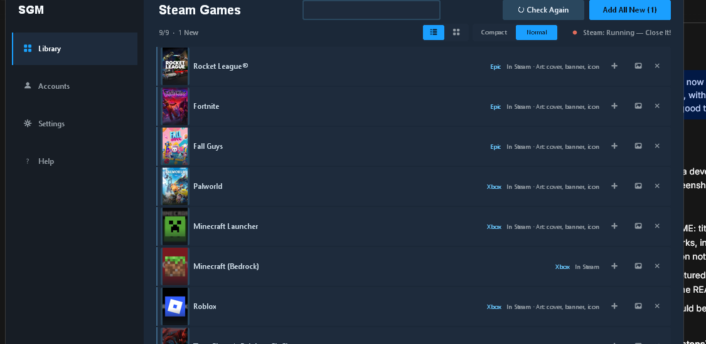

# Steam Games Manager

Bring your Epic, GOG, Xbox, Ubisoft, EA, and Battle.net games into Steam as
non-Steam shortcuts — with proper cover art, banners, logos, and icons, no
SteamGridDB key required.



## What it does

- Scans every major PC launcher on your machine and lists the games it finds.
- Adds any game to Steam's `shortcuts.vdf` with one click (or one command),
  backed up before every write.
- Fetches artwork automatically: each launcher's own cached art first,
  then keyless catalog lookups, with SteamGridDB as an optional upgrade.
- Refuses to write while Steam is running, unless you explicitly force it.
- Remembers what's already imported, so re-runs only touch what's new.

## Supported launchers

| Launcher | Detection | Artwork source |
|---|---|---|
| Epic Games Store | `Manifests/*.item` + `catcache.bin` | Catalog cache, then catalog search |
| GOG Galaxy | Registry + `galaxy-2.0.db` | Galaxy webcache covers, then catalog |
| Xbox / Game Pass | AppX packages + `.GamingRoot` | `MicrosoftGame.config` images, manifest logos |
| Ubisoft Connect | Registry + local configurations cache | Ubisoft CDN thumbnails and logos |
| EA App | Uninstall records + bundled title list | Title list, then the game's exe icon |
| Battle.net | Agent `product.db` + `aggregate.json` | Agent logos, then hosted covers |
| Desktop | Win32 games outside launcher manifests (Roblox Studio) | Online lookup |

## Artwork

Four kinds per game, matching Steam's grid filenames: cover (`<appid>p.jpg`,
600x900), hero (`<appid>_hero.jpg`), logo (`<appid>_logo.png`), and icon
(`<appid>.ico`). Local store art always wins over online results. Square-only
logos (Minecraft, Roblox) are composed over a blurred splash backdrop instead
of being stretched.

## Quick start

Download `SteamGamesManager.exe` from Releases, close Steam, and run it.
Pick your launchers at the bottom, click **+** on a game (or **Add All New**),
then restart Steam.

CLI, for scripting:

```powershell
pip install -r requirements.txt

# Scan only, change nothing
python -m steam_games_manager --dry-run

# Full import (prompts for a SteamGridDB key only if you want it)
python -m steam_games_manager --api-key SGDB_KEY --launchers epic,gog,xbox

# Non-interactive, specific user
python -m steam_games_manager --user-id 12345678 --no-prompt --force
```

| Option | Effect |
|---|---|
| `--launchers` | Comma list: `epic,gog,xbox,ubisoft,ea,battlenet,desktop` |
| `--dry-run` | Scan and report without writing |
| `--no-artwork` | Skip all artwork downloads |
| `--overwrite` | Update already-imported shortcuts |
| `--force` | Write even if Steam is running (risky) |
| `--prune` | Remove leftover system-junk entries |
| `--include TEXT` | Only import games whose name contains `TEXT` |
| `--gui` | Launch the graphical interface |

Steam must be closed before writing. The tool aborts if `steam.exe` is
running unless `--force` is passed.

## Project layout

```
steam_games_manager/
    gui.py               # Steam-styled library UI
    main.py              # CLI entry
    scanners/            # one module per launcher
    artwork/             # SteamGridDB client + keyless providers
    vdf_handler/         # binary shortcuts.vdf codec, AppID math
    utils/               # process guard, icons, file helpers
tests/                   # 62 tests, run with: python -m pytest -q
```

## Building the exe

```powershell
python -m PyInstaller --noconfirm SteamGamesManager.spec
```

Output lands in `dist\SteamGamesManager.exe`.

## License note

Ubisoft record parsing, the Battle.net protobuf schema, and the EA title list
are derived from [DLSS Swapper](https://github.com/beeradmoore/dlss-swapper)
(GPL-3.0). Check license compatibility before distributing builds.
