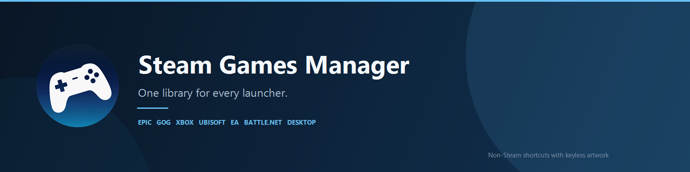
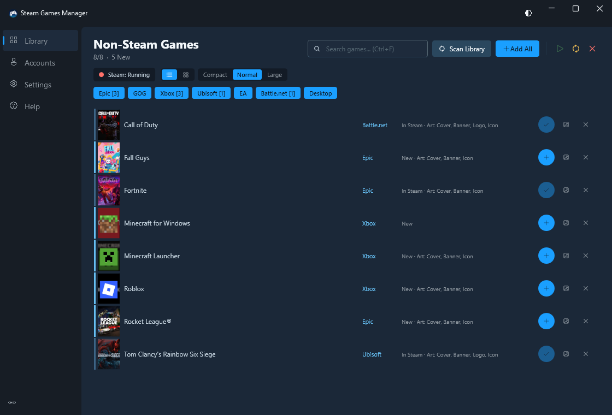
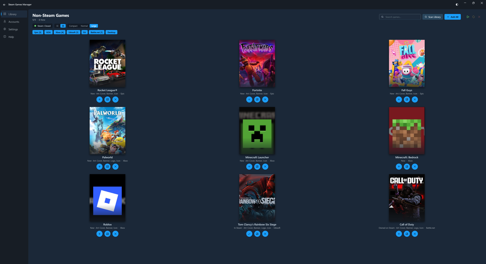
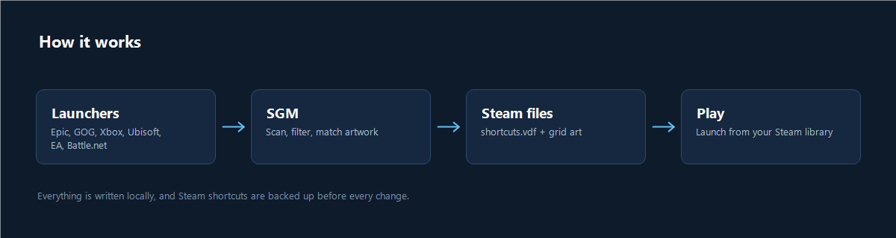

# Steam Games Manager



[](https://github.com/xHybred/SteamGamesMananger/releases)


Steam Games Manager (SGM) brings the games you already own on other launchers into Steam as
non-Steam shortcuts, complete with cover art, banners, logos and icons. It scans your installed
games, resolves artwork from local caches and public catalogs, and writes everything into Steam's
own files. A SteamGridDB key is optional, not required.

## Highlights

- **One library, A to Z.** Every enabled storefront is merged into a single alphabetical list.
- **One-click import.** Add a game individually or use Add All for everything new.
- **Artwork matching.** Covers, heroes, logos and icons are pulled from launcher caches,
  keyless catalogs and the installed game itself. SteamGridDB can be added for custom art.
- **Safe writes.** `shortcuts.vdf` is backed up before every change, and SGM refuses to write
  while Steam is running unless you explicitly force it.
- **Built for a large library.** Search, per-launcher filters, list and grid views, and three
  density levels keep hundreds of games manageable.
- **Launch-aware shortcuts.** Each launcher gets the right command line, from Epic's URI protocol
  to Xbox's `shell:AppsFolder` entries and Battle.net's direct launch codes.
- **Configurability.** Hide a game and undo it with Ctrl+Z, or match different artwork at
  any time. Window size and layout are remembered between sessions.

## Screenshots





## How it works



1. SGM scans the launchers you enable using their local manifests, databases and install folders.
2. Games are deduplicated, sorted and matched with artwork.
3. Shortcuts and grid images are written to your Steam userdata folder.
4. Restart Steam and the games appear in your library alongside your Steam titles.

## Supported launchers

| Launcher | Detection | Artwork |
| --- | --- | --- |
| **Epic Games** | `Manifests/*.item` plus `catcache.bin` | Catalog cache, then online search |
| **GOG Galaxy** | Registry install path plus `galaxy-2.0.db` | Galaxy web cache, then catalog |
| **Xbox / Game Pass** | AppX packages whose identity is registered in a `.GamingRoot` `MicrosoftGame.config` | `MicrosoftGame.config` art and package manifest logos |
| **Ubisoft Connect** | Registry plus the local configurations cache | Ubisoft CDN thumbnails and logos |
| **EA app** | Uninstall records plus a bundled title list | Title list, then the game's executable icon |
| **Battle.net** | Agent `product.db` plus `aggregate.json` | Agent logos, then hosted covers |
| **Desktop** | Win32 games outside any launcher manifest | Online lookup |

### Xbox and Game Pass

Xbox games are only listed when Windows has registered them as real games: the package identity
must match a `MicrosoftGame.config` inside an install folder recorded by a `.GamingRoot` drive
marker. Frameworks, resource packages, and Microsoft Store apps without that registration are
excluded, which keeps the list free of runtimes, codecs, language packs and storefront utilities.
Titles launch through `explorer.exe shell:AppsFolder\...`, exactly like the Xbox app does.

### Battle.net

Battle.net titles use the best launch method available:

1. A documented launch code starts the game directly:
   `Battle.net.exe --exec="launch <code>"`.
2. Without a code, SGM opens the game's page in the client:
   `Battle.net.exe --uri="battlenet://game/<product-code>"`.
3. If neither is known, the client simply opens.

Launch codes are sourced from community documentation and only used when a reliable source lists
them and no other source contradicts the code.

## Artwork

Steam expects four image types per shortcut:

| Type | File | Size |
| --- | --- | --- |
| Cover | `<appid>p.jpg` | 600 x 900 |
| Hero | `<appid>_hero.jpg` | 1920 x 620 |
| Logo | `<appid>_logo.png` | Transparent PNG |
| Icon | `<appid>.ico` | Multi-size icon |

Local launcher art always wins. When only a square logo is available, SGM composes it over a
blurred splash image so the result still fills a 600 x 900 cover. A SteamGridDB API key is only
needed when you want to choose custom artwork or fill gaps in the keyless catalogs.

## Getting started

1. Download the latest release from
   [Releases](https://github.com/xHybred/SteamGamesMananger/releases). The portable
   `SteamGamesManager.exe` is self-contained and does not need a separate .NET install.
2. Close Steam. The status pill in the header turns green when it is safe to write.
3. Enable the launchers you use in the sidebar.
4. Press **Add All** to import every new game, or use the plus button on individual rows.
5. Restart Steam. Your shortcuts and artwork are ready.

If Steam is running, SGM still scans but will not write shortcuts unless the force option is
enabled. Before each write it saves a timestamped backup next to `shortcuts.vdf`
(`shortcuts.vdf.bak-<timestamp>`).

## Keyboard shortcuts

| Shortcut | Action |
| --- | --- |
| `Ctrl+F` | Focus the search box |
| `F5` | Rescan all launchers |
| `Esc` | Clear the search |
| `Ctrl+Z` | Undo the last hidden game |

## Command line

The `sgm` CLI exposes the same scan and import pipeline for scripts and scheduled runs.

```console
sgm --dry-run
sgm --api-key SGDB_KEY --launchers epic,gog,xbox
sgm --user-id 12345678 --force
```

| Option | Description |
| --- | --- |
| `--launchers <list>` | Comma-separated launchers to scan (`epic,gog,xbox,ubisoft,ea,battlenet,desktop`) |
| `--steam-dir <path>` | Steam installation directory |
| `--user-id <id>` | Steam userdata account to write to |
| `--api-key <key>` | SteamGridDB key, or set `STEAMGRIDDB_API_KEY` |
| `--no-artwork` | Skip artwork downloads and composition |
| `--dry-run` | Report what would change without writing |
| `--overwrite` | Update shortcuts that were already imported |
| `--force` | Write even while Steam is running |
| `--prune` | Remove OS and UWP junk entries before merging |
| `--include <text>` | Only import games whose name contains the text |
| `--epic-manifests <path>` | Override the Epic manifests directory |
| `--gog-db <path>` | Override the GOG Galaxy database path |
| `--gui` | Launch the desktop interface |
| `--version` | Print the version |
| `-h`, `--help` | Show help |

Steam must be closed unless `--force` is used.

## Building

Requirements: Windows 10 or 11 and the .NET 10 SDK.

```console
dotnet build Sgm.slnx -c Release
dotnet test Sgm.slnx -c Release
```

Outputs:

- GUI: `Sgm.App\bin\Release\net10.0-windows\SteamGamesManager.exe`
- CLI: `Sgm.Cli\bin\Release\net10.0-windows\sgm.exe`

### Single-file release

To produce one self-contained executable with the runtime and native libraries bundled:

```console
dotnet publish Sgm.App\Sgm.App.csproj -c Release -r win-x64 --self-contained true -p:PublishSingleFile=true -p:IncludeNativeLibrariesForSelfExtract=true -p:EnableCompressionInSingleFile=true -p:PublishTrimmed=false -p:DebugType=None -p:DebugSymbols=false -o public-release
```

The resulting `public-release\SteamGamesManager.exe` is the only file needed to run the app.

## Project layout

```text
Sgm.App          WPF desktop application
Sgm.Cli          Command-line interface (sgm)
Sgm.Core         Scanners, artwork pipeline, Steam VDF writing
Sgm.Core.Tests   Unit tests for the core library
Sgm.slnx         Solution file
```

## Notes and attribution

SGM is a Windows-only WPF application built with C# and .NET 10. It does not modify game files;
it only adds shortcuts and artwork to your Steam userdata.

Detection and parsing for some launchers was informed by publicly available reverse-engineering
work, including [DLSS Swapper](https://github.com/beeradmoore/dlss-swapper) (GPL-3.0) for Ubisoft,
EA and Battle.net data formats. Review the relevant licenses before redistributing derived code
or data.
